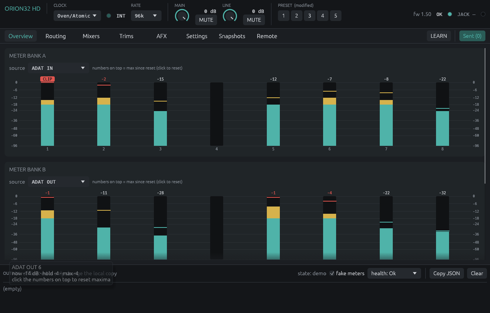
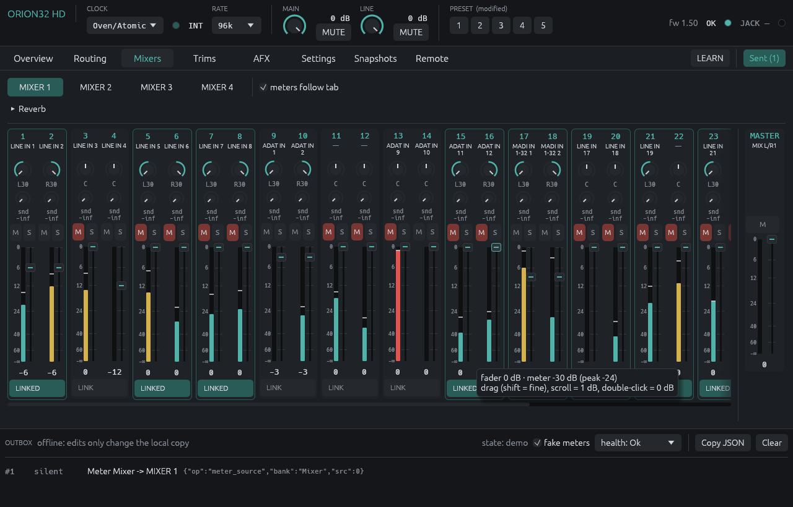
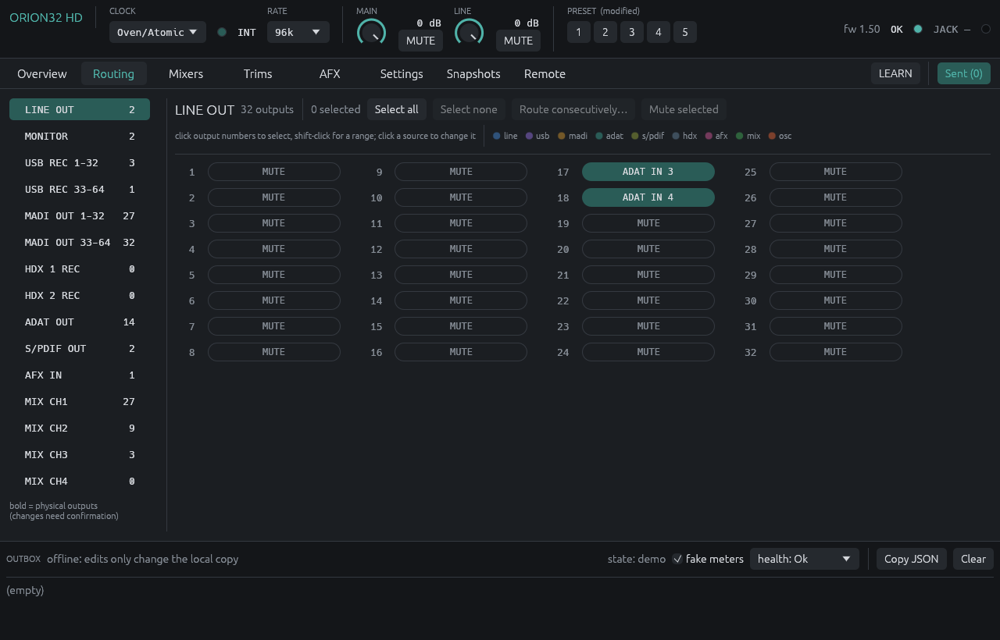
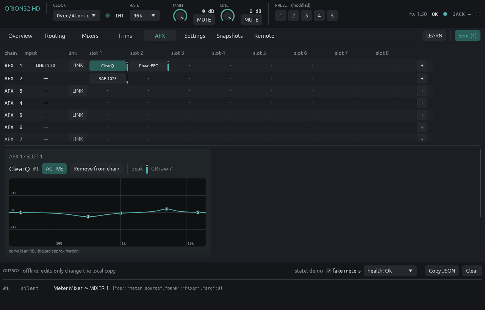
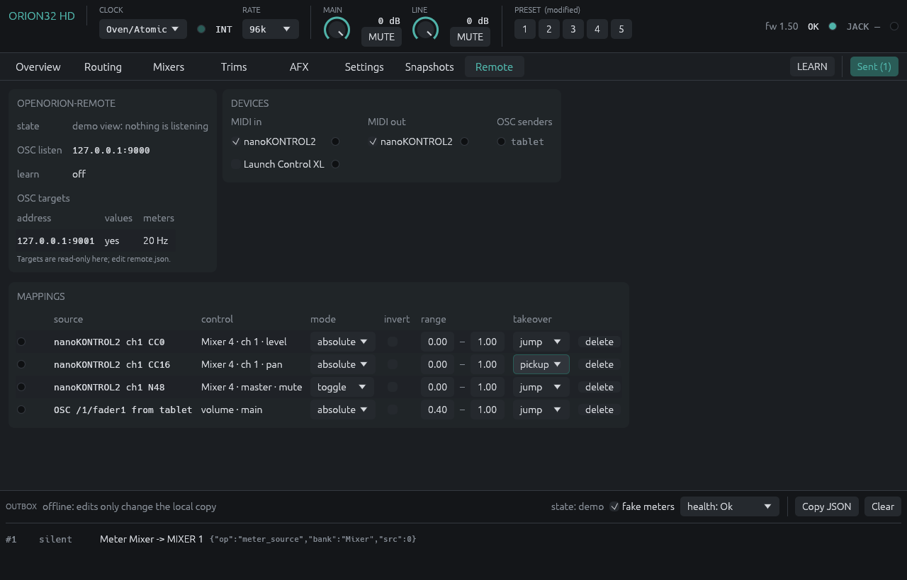

# openorion

An independent, offline control tool for the **Antelope Audio Orion32 HD**
audio interface (USB `23e5:a210`) on Linux. Linux support for this device
is the scope of the project.

It lets owners control their interface on Linux without needing a
Windows or macOS computer for its settings.

openorion is not affiliated with, endorsed by or supported by Antelope
Audio. See [LEGAL.md](LEGAL.md).

## What it does

Audio itself needs nothing from this project: the Orion32 HD is a standard
USB Audio Class 2 device, and Linux's `snd-usb-audio` streams 64 in / 64 out
at 32 to 192 kHz on a USB3 port (8 / 8 on USB2).

openorion handles the device's settings over its HID control interface:
routing, the four mixers and reverb, clock source and sample rate, trims,
volumes and mutes, the oscillator, S-MUX and SRC, presets, power, meters,
and the onboard AFX effect chains.

| part | binary | purpose |
|---|---|---|
| daemon | `openoriond` | owns the device, serves clients over a Unix socket |
| CLI | `openorion` | supported settings, snapshots, live meters; `--direct` runs without the daemon |
| GUI | `openorion-ui` | mixers, routing, AFX, settings (egui) |
| JACK helper | `openorion-jack` | JACK port names that follow routing, rate guard, MIDI control, setup doctor |
| remote | `openorion-remote` | OSC and MIDI controllers with learn from the GUI, OSC values and meters out, controller LED feedback and pad meters |

The command encoder excludes firmware updates, activation and licensing
writes, and factory reset. The project is intended to control features
you are entitled to use; see [LEGAL.md](LEGAL.md) for its scope and
protocol restrictions. Use it at your own risk: it changes the settings
of real studio hardware.

## Screenshots

The GUI in its offline demo mode (`openorion-ui --demo`, made-up state).







## Install (Linux)

The installer targets x86-64 Linux. Building requires Rust 1.95 or newer,
a C toolchain with musl support, and the development libraries needed by
eframe, JACK and ALSA (including `pkg-config` and the JACK and ALSA
development files; ALSA is for `openorion-remote`'s MIDI).
The GUI uses the host graphics/windowing libraries. Package names vary
by distribution. Run the following from the repository root:

```
rustup target add x86_64-unknown-linux-musl
sh packaging/install.sh
systemctl --user daemon-reload && systemctl --user enable --now openoriond
```

`install.sh` builds static `openoriond` and `openorion` (musl) and host builds of
`openorion-ui` and `openorion-jack`, puts them in `~/.local/bin`, and installs the
udev rule (sudo), the systemd user unit and the desktop file. The udev rule
gives the logged-in seat and the `audio` group access to the Orion's
hidraw and USB device nodes.

For JACK, run `jackd -d alsa -d hw:Orion32HD` (or PipeWire's JACK layer);
`openorion-jack doctor` checks the setup.

## Use

```
openorion status
openorion route set "USB REC:1" "LINE IN:1" --count 8
openorion mixer set 1 3 --level -12 --pan L10
openorion snapshot save studio.json
openorion snapshot restore studio.json
openorion meters
openorion health            # is the control channel answering? what to do if not
```

The CLI asks for confirmation for disruptive operations (clock, rate,
power, presets, routing to physical outputs), or requires `--yes` when
used noninteractively. Ordinary audible controls such as volume, mute
and mixer faders take effect without confirmation.

The device's control channel can hang. `openorion health` shows whether
settings are accepted and what to do; `openorion health --recheck`
probes it again (reads only) and recovers from a transient hang. When it
says to power-cycle the Orion, a USB reset will not help.

A power cycle resets the Orion's AFX settings to factory defaults
(routing and mixers survive). `openoriond` keeps a copy of the AFX
settings in `~/.local/state/openorion/afx.json` and puts them back after
the Orion comes up again; effects changed to other values meanwhile are
left alone. Start the daemon with `--no-afx-restore` to turn this off.
For everything else, save a device preset or an `openorion snapshot`.

Run `openorion --help` and `openorion <command> --help` for command options.
`openorion-ui` connects to the daemon; `openorion-ui --demo` runs an
offline preview. `--direct` requires exclusive device ownership: stop
`openoriond` before using it with hardware.

The installer enables JACK support in the helper build. For a manual
build, use `cargo build -p openorion-jack --features jack`. Run
`openorion-jack --help-midi` for the plain-text MIDI mapping format.

## Documentation

- [docs/protocol-spec.md](docs/protocol-spec.md): the control protocol as
  implemented, each item tagged with how it was established.
- [docs/DESIGN.md](docs/DESIGN.md): architecture.

## License

GPL-3.0-or-later. See [LICENSE](LICENSE).

"Antelope Audio" and "Orion32" are trademarks of their owners. They are
used here only to say which hardware this software works with. The names
of the onboard effect models are likewise used only to identify them.
